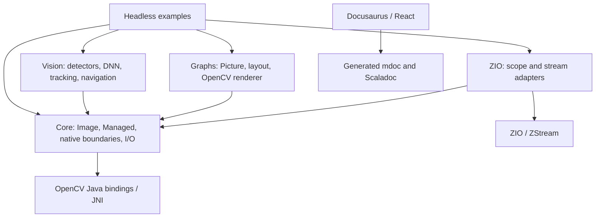

# Quality review

Initial audit reviewed 2026-10-22 at `e39da7e8c915aee48e65a09f01a6f8975e248c9c` on `master`.

## Executive summary

- All F01–F11 findings are implemented: native-loading causes are preserved, paused resize retains the frozen composition, and website release copy matches the README/build.
- The normal suites now pass 988 tests with four expected skips; the separate model-enabled SFace suite passes all 12 tests. Builds, configured static checks, documentation/site builds, native leak tests, and all 20 historical ABI comparisons pass.
- Private clipping and tracking phases are separated; the animation component is reduced from 759 to 348 lines under rendering/lifecycle characterization tests. Release verification now has deterministic retry, mismatch, deadline, and transport coverage.
- Public library signatures, numerical behavior, runtime dependencies, lockfiles, and workflows are unchanged. Work was committed directly on `master`; the original untracked cache files remain untouched and nothing was pushed.
- Residual limits include documented native-shutdown exit variability, controlled-canvas rather than real-browser tests, the new website test command not yet wired into CI, and unavailable hardware/platform/consumer/book checks. Details and exact verification evidence follow.

## Scope and stop condition

`main` does not exist. `git symbolic-ref refs/remotes/origin/HEAD` returned `refs/remotes/origin/master`, and `master` was already checked out. No branch switch was necessary. Initial `git status --porcelain=v1 --untracked-files=all` reported:

```text
?? ci/__pycache__/validate-release.cpython-314.pyc
?? ci/__pycache__/verify-published.cpython-314.pyc
?? ci/tests/__pycache__/test_release.cpython-314.pyc
```

These pre-existing generated files were left untouched. They trigger the requested dirty-worktree stop regardless of their origin. The initial audit added only this review and deferred Phases 2–4 until explicit authorization to proceed.

State revalidation on 2026-10-22 confirmed the same `master` HEAD, no tracked or staged differences (`git diff --exit-code HEAD` and `git diff --cached --exit-code` both exit 0), and only this review plus the three original bytecode files untracked. Retained baseline logs and full-suite XML reports were checked against the results below. Build and test commands were not repeated during this state check because the reviewed source is unchanged. At that point the dirty-worktree stop applied, and no commit or push had been performed.

The audit covered tracked Scala library/test/example/benchmark sources, the Mill build, Python and shell tooling, website TypeScript/JavaScript/CSS/configuration, CI definitions, and supporting documentation. Detailed inspection concentrated on ownership, native boundaries, streaming, downloads, numerical geometry, release verification, and churn hotspots. Supporting prose was sampled; the entire book was not independently validated. No applicable `AGENTS.md` was found in the repository or its ancestors.

Excluded from source refactoring: `out/`, `target/`, `.mill-daemon/`, IDE caches, Python bytecode, website `node_modules/`, `build/`, `.docusaurus/`, generated `docs/` and `static/api/`, generated `BuildValues.scala`, `website/package-lock.json`, binary assets/book PDF, and the upstream Mill bootstrap. Exclusions follow `.gitignore`, `website/.gitignore`, build source generation, and conventional generated/vendor paths. No database migrations or database modules were found. Running builds regenerated ignored outputs; none were edited by hand.

## Baseline

Toolchain: Scala 3.3.8, Mill 1.1.9, module JDK selection `zulu:25`, Java 17 bytecode target, OpenCV 4.14.0-1.5.14, MUnit 1.3.6, MUnit ScalaCheck 1.3.1, and ZIO/ZIO Test 2.1.26. Host commands report Temurin 25.0.4.1, Python 3.14.8, Node 24.22.0, and npm 12.2.0. Website: Docusaurus 3.10.2, React 19, TypeScript 7. No website unit/browser test framework is configured.

Commands were derived from `build.mill`, `CONTRIBUTING.md`, `RELEASING.md`, `website/package.json`, and `.github/workflows/ci.yml`. Unless stated otherwise they ran from the repository root. Mill checks used the existing build cache; this was not a clean rebuild. Raw logs and temporary diagnostic probes are retained at `/tmp/scalacv-quality-review.gzV06e/` for this workspace session.

| Check | Exact command | Actual result |
| --- | --- | --- |
| Headless build | `./mill core.compile vision.compile graphs.compile zio.compile examples.compile` | Exit 0; all five modules pass; no compiler warnings emitted in this invocation. |
| Full module tests | `./mill core.test + vision.test + graphs.test + zio.test + examples.test` | Exit 0; 948 discovered, 944 passed, 4 skipped, 0 failures. |
| Native leak tests | `./mill leaks.test` | Exit 0; 9 passed, 0 failures/skips. |
| Format | `./mill mill.scalalib.scalafmt.ScalafmtModule/checkFormatAll` | Exit 0; checked 188 Scala sources, no reported violations. |
| Production static analysis | `./mill core.fix --check + vision.fix --check + graphs.fix --check + zio.fix --check + examples.fix --check` | Exit 0; OrganizeImports check, 99 sources, no reported violations. |
| Test static analysis | `./mill core.test.fix --check + vision.test.fix --check + graphs.test.fix --check + zio.test.fix --check + examples.test.fix --check + leaks.test.fix --check` | Exit 0; OrganizeImports check, 75 source inputs, no reported violations. Shared fixture inputs can occur in multiple modules. |
| Release tooling tests | `PYTHONDONTWRITEBYTECODE=1 python3 -m unittest discover -s ci/tests -v` | Exit 0; 6 passed. |
| Shell syntax | `bash -n <file>` for each tracked `.sh` file | All 6 pass: `ci/consumer-smoke/run.sh`, `create-issues.sh`, `docs/book/build.sh`, `docs/book/check-chapter.sh`, `scripts/assemble-docs.sh`, `scripts/create-docs-issues.sh`. Scripts that create remote issues were not executed. |
| TypeScript | `npm run typecheck` in `website/` | Exit 0; no diagnostics emitted. |
| Documentation snippets | `./mill docs.mdocCheck` | Exit 0; cached task result. |
| Native loading smoke | `./mill examples.runMain scalacv.smoke` | Exit 0 and `OK` success marker. |
| Documentation assembly | `./scripts/assemble-docs.sh` | Exit 0; mdoc runs, Scaladoc builds, all checked API file links resolve. |
| Website production build | `npm --prefix website run build` | Exit 0; static files generated, no broken-link/anchor error reported. Existing installed dependencies used; no dependency installation or lockfile change. |
| Optional source builds | `./mill benchmarks.compile examples-gui.compile` | Exit 0; cached compilation. GUI/hardware applications and benchmarks were not executed. |
| ABI checker controls | `PYTHONDONTWRITEBYTECODE=1 python3 ci/binary-compatibility.py --self-test` | Exit 0; positive comparison, removed-method/finality negative controls, and old-client finality check pass. |
| Historical ABI comparisons | `PYTHONDONTWRITEBYTECODE=1 python3 ci/binary-compatibility.py` | Exit 0; all 20 comparisons pass: core, vision, graphs, and zio against each of v0.4.0–v0.4.4. Checker controls also pass. Evidence: `/tmp/scalacv-abi-q3wygm3m/`. Temporary baseline clones/builds did not change the working branch or history. |

Test counts are taken from the newly produced `testForked.dest/test-report.xml` files, not source-level counts of `test(...)` declarations:

| Suite | Discovered | Passed | Skipped | Failed |
| --- | ---: | ---: | ---: | ---: |
| core | 536 | 535 | 1 | 0 |
| vision | 239 | 236 | 3 | 0 |
| graphs | 133 | 133 | 0 | 0 |
| zio | 34 | 34 | 0 | 0 |
| examples | 6 | 6 | 0 | 0 |
| leaks | 9 | 9 | 0 | 0 |
| Python release tooling | 6 | 6 | 0 | 0 |
| **Total** | **963** | **959** | **4** | **0** |

Exact skipped set:

- `scalacv.VideoTest.a real camera delivers frames of the size it reports` — opt-in `SCALACV_CAMERA` hardware test.
- `scalacv.CascadesTest.resolve on Windows explains that the jar ships none` — platform-specific assumption.
- `scalacv.CascadesTest.load on a name the platform jar does not ship is a Left, never a silent empty classifier` — platform-specific assumption.
- `scalacv.FaceRecognizerTest.end to end: the same face embeds consistently (needs SCALACV_SFACE_MODEL + network)` — `SCALACV_SFACE_MODEL` is unset.

**Baseline failing set: empty.** The native library deliberately logs errors for invalid-input tests; these are not test failures. Counts of native `[ WARN:` records were 77 in the full module test log, 141 in the leak test log, and 6 during documentation assembly. Fresh mdoc assembly reports **0 errors, 1,143 warnings**, all 1,143 matching `Unknown link` diagnostics for website-style routes. Scaladoc emits one unresolved-member warning at `vision/src/scalacv/vision/Odometry.scala:40` (F11). Docusaurus and the assembly script subsequently validate site anchors and API file links successfully. Warning counts describe this run, not a zero-warning claim for a clean build or other JDKs.

Historical ABI builds additionally emit 44 `WARNING:`-prefixed JVM diagnostic lines about Unsafe/native access; these are repeated diagnostic lines, not 44 distinct compiler findings. All 20 ABI comparisons succeed.

No coverage instrumentation/report task is configured; statement/branch coverage percentages and formal cognitive-complexity/duplication metrics are **not available**. Scalafix is configured only for OrganizeImports; compiler flags add unused/value-discard/non-unit checks with `-Werror` in production. Those gates do not constitute a security analyzer. Sonar scanner, Ruff, and ShellCheck are not installed; Sonar server/token configuration is absent. Manual review supplemented the configured Scala tools; no analyzer was installed or rule suppressed.

Not verified: packaged resolver consumers (`cs` is absent), Typst book compilation (`typst` is absent), real camera input, SFace model inference, JDK 17/21 runtime matrix, macOS/Windows native execution, live GUI interaction, and remote publication/signing. Release jobs requiring tags and credentials were inspected, not invoked. The separate Java stress program embedded in CI was not run; the configured nine-test RSS suite was run. No external dependency-vulnerability database scan was performed.

## Architecture sketch

Arrows below mean source/build dependency, not data flow:



The four published modules form a shallow dependency star (`build.mill:286`, `:353`, `:367`, `:384`). `core.test` deliberately adds integration-only dependencies on the other modules (`build.mill:330`); that is not a production dependency cycle. No source import from `core/src` back into vision/graphs/zio was found. Vision domain extensions keep `Image` independent of optional layers. `Renderer` and `TextMeasurer` provide existing backend seams; `OcrEngine` is an existing I/O boundary. The native wrapper's dependency on OpenCV is its purpose, not by itself a Clean Architecture violation. Geometry conversion helpers are deliberate adapters on immutable values.

Library entry points include `OpenCv.load`, `Image.read/reading/scoped`, `Video.open/frames`, `Camera`, `Recorder`, `Models.fetch/fetchCached`, and the ZIO scope/stream functions. Examples provide runnable smoke/demo entry points. Unpublished modules comprise headless examples, GUI examples, benchmarks, leak tests, unified API docs, and mdoc. CI covers JDK 17/21/25 on Linux, Apple Silicon natives, style, RSS tests, docs, publication shape, ABI comparisons, packaged consumers, and release tooling. Release workflows consume a validated commit before publishing. No server/database/controller layer exists to assess for SQL injection, N+1 queries, or schema migrations.

## Hotspots and maintainability evidence

Churn command: `git log --since=12.months --format= --name-only | sort | uniq -c | sort -rn | head -30`. The raw result includes historical deleted files and excluded lockfiles; those are not refactoring targets. To cross churn with complexity, the following screen counts `if`, `while`, `for`, and `catch` tokens after removing comments and string literals from Scala/TypeScript sources. It excludes `case` so exhaustive ADT matches are not penalized. The product is a coarse prioritization heuristic, **not** Sonar cognitive complexity, a defect count, or a performance measurement.

| File | Changes in window | Physical lines | Branch tokens | Churn × tokens | Assessment |
| --- | ---: | ---: | ---: | ---: | --- |
| `core/src/scalacv/Video.scala` | 9 | 531 | 17 | 153 | Substantial documentation; existing shared FrameSource and lifetime tests justify keeping structure. |
| `core/src/scalacv/OpenCv.scala` | 8 | 288 | 16 | 128 | Platform-sensitive loader; F01 diagnostic loss confirmed. |
| `core/src/scalacv/Models.scala` | 9 | 367 | 12 | 108 | Existing download/verify/cache seams and extensive error/concurrency tests. |
| `graphs/src/scalacv/graphs/Graphics.scala` | 5 | 239 | 17 | 85 | F05: private dashed-line geometry and raster work are intertwined. |
| `website/src/components/VisionPipeline/index.tsx` | 2 | 759 | 41 | 82 | F03/F08: large untested lifecycle/rendering unit. |
| `core/src/scalacv/Image.scala` | 25 | 512 | 3 | 75 | High churn, mostly thin delegation and ownership documentation; size alone is not a smell. |
| `vision/src/scalacv/vision/OccupancyGrid.scala` | 4 | 187 | 18 | 72 | F06: exact clipping and occupancy updates share one method. |
| `core/src/scalacv/Ops.scala` | 24 | 556 | 1 | 24 | High churn, low control-flow complexity; public extension-holder compatibility makes file moves risky. |
| `vision/src/scalacv/vision/ObjectTracker.scala` | 3 | 188 | 5 | 15 | F07: multiple mutation phases in one update. |

`build.mill` changed 35 times; ZIO bindings changed 13 times. Build/CI changes and public API reorganizations are excluded from autonomous remediation. Function spans verified from source: `Graphics.dashSegment` 62 physical lines, `OccupancyGrid.observe` 48, `ObjectTracker.update` 45, and the main `VisionPipeline` effect 298. Existing formatter/linter configuration sets no cognitive-complexity threshold; the requested ~30-line heuristic motivated inspection, not automatic findings. No broad formatting or speculative abstraction is recommended.

## Findings

Risk describes the proposed change. Coverage means relevant existing automated coverage, not coverage of every reported edge case. This table records the initial findings. Bug fixes and altered observable diagnostics are distinct from behavior-preserving refactors; execution status is recorded below.

| ID | Severity | Category | Location | Evidence | Principle | Proposed refactoring | Risk | Effort (S/M/L) | Test coverage (yes/partial/no) | Source (tool/manual) |
| --- | --- | --- | --- | --- | --- | --- | --- | --- | --- | --- |
| F01 | Medium | Reliability / diagnostics | `core/src/scalacv/OpenCv.scala:62`; `core/src/scalacv/CvError.scala:19` | Both loader catch branches pass only the message into `NativesMissing`, leaving its existing cause parameter null. An isolated JVM without classifier jars reproduced this. The original loader stack and nested cause are lost when diagnosing deployment failures. | Martin: preserve error context | **Behavior-change proposal:** retain the original throwable using the existing cause parameter. Do not mix it with loader restructuring. | Low implementation risk; observable exception cause changes | S | partial | manual; tool:javac/java probe |
| F02 | Medium | Tests / false assurance | `vision/test/src/scalacv/FaceRecognizerTest.scala:112` | After model opt-in, download failure and empty detection still use `assume` at lines 116/129. Only one embedding is produced; comparing it with itself at line 132 passes for any nonzero constant 128-vector. Inference repeatability/discrimination can regress without this smoke test failing. | Feathers: meaningful safety net; Meszaros: conditional tests | Separate infrastructure availability from test assertions; exercise independently obtained embeddings and a deterministic detection/landmark fixture. Keep generated-fixture conventions. | Medium: model/fixture portability; release-gating policy needs a decision | M | partial | manual |
| F03 | Medium | Reliability / UI | `website/src/components/VisionPipeline/index.tsx:587`; `:663` | Resize assigns canvas width/height, clearing its bitmap. It repaints only for reduced motion; the paused animation loop returns without drawing. A probe executing the extracted callbacks with a canvas lifecycle stub observed zero redraws after resize while paused, then one on resume. | Separate rendering from animation scheduling | **Bug-fix proposal:** repaint the current frozen composition on resize without advancing time. This is not a structural-only change. | Low; verify paused timestamp and reduced-motion behavior | S | no | manual; tool:node lifecycle probe |
| F04 | Medium | Reliability / installation docs | `website/src/components/Hero/index.tsx:19`; `:104`; `website/docusaurus.config.ts:16`; `README.md:33` | Hero copy/install text says 0.4.3; README targets 0.4.4. Site metadata says OpenCV 4.13 while `build.mill:14` pins 4.14. Users following two entry points install different advertised versions. The native-coordinate scan in `core/test/src/scalacv/BuildVersionsTest.scala:56` does not cover these website strings. | Beck: eliminate duplicated knowledge | **Content/behavior proposal:** agree the intended released version, synchronize copy, then extract a shared website release constant and add a consistency check. Do not substitute an unreleased VCS version automatically. | Low; release availability must be confirmed before changing recommendations | S | partial | manual |
| F05 | Medium | Maintainability / long function | `graphs/src/scalacv/graphs/Graphics.scala:160` | The 62-line, seven-parameter `dashSegment` combines clipping, floating-point resolution checks, dash phase progression, and JNI painting. Changing viewport clipping requires reasoning about both invisible-path phase and visible pixel output in one block. | Fowler: Extract Function; separate levels of abstraction | Extract the private clipping calculation while preserving evaluation order, failure messages, phase, and pixel arithmetic. Keep the renderer API unchanged. | Medium: floating-point rounding and phase are observable | M | yes | manual |
| F06 | Medium | Maintainability / mixed geometry and mutation | `vision/src/scalacv/vision/OccupancyGrid.scala:50` | `observe` spans 48 lines and combines coordinate conversion, mutable exact-fraction clipping state, endpoint rounding, and log-odds writes. Numerical changes cannot be reviewed independently of map mutation. | Fowler: Extract Function / Split Phase | Extract a private clipped-ray calculation; retain exact fractions and update order. Avoid changing the public coordinate API or using approximate Double clipping. | Medium: extreme-coordinate and boundary behavior | M | yes | manual |
| F07 | Medium | Maintainability / long function | `vision/src/scalacv/vision/ObjectTracker.scala:65` | The 45-line `update` predicts/mutates tracks, associates detections, corrects matches, creates native filters, retires tracks, and constructs output. Adding one lifecycle rule requires tracking six phases and index relationships through the same method. | Fowler: Extract Function; Martin: one abstraction level | Extract private named prediction, correction, creation, retirement, and result-query steps, one extraction at a time. Preserve mutation/exception order and greedy tie behavior. | Medium: identities, counters, resource lifetimes | M | partial | manual |
| F08 | Medium | Maintainability / testability | `website/src/components/VisionPipeline/index.tsx:124`; `:392`; `:458` | The file has 759 lines; a 298-line effect owns image processing, drawing, clocks, observers, resizing, and cleanup. `renderStage` alone spans 108 lines. Only type/build checks exist, so lifecycle coupling such as F03 has no regression safety net. | Feathers: seams; Fowler: Extract Function / Move Function | Characterize animation/resize behavior first, then extract private raster operations and clock calculations while keeping React lifecycle ownership explicit. Do not introduce a framework or change visuals as part of extraction. | Medium; requires deterministic pixel/clock and lifecycle tests | M | no | manual |
| F09 | Medium | Tests / release verification seam | `ci/verify-published.py:43`; `ci/tests/test_release.py:48` | `main` combines artifact discovery, HTTP retry/deadline handling, body reads, and hash comparison. Tests exercise headers/payload shape, but never remote mismatch, retry exhaustion, or transport failure. These are the conditions that must prevent announcing a bad release. | Feathers: introduce a seam; Fowler: Extract Function | Propose a separately approved tooling change: extract fetch/verify functions with injectable transport and clock; characterize current retry/deadline semantics before changing policy. | Medium; CI/release tooling changes require approval | M | partial | manual |
| F10 | Low | Documentation / stale architecture record | `DESIGN.md:36`; `:78`; `:87` | The design record says no Prism swizzle and no custom React components, but `website/src/theme/prism-include-languages.js:38` and six component entry points exist. Upgrade reviewers are directed to a false inventory. | Martin: comments/docs explain current intent | Update the inventory and record the existing swizzle's rationale, without removing working components. | Low | S | no | manual |
| F11 | Low | Documentation / unresolved API link | `vision/src/scalacv/vision/Odometry.scala:37` | Scaladoc reports an unresolved `IllegalStateException` member link at the `update` declaration, leaving the throws documentation without a resolved target. | Maintain documentation contracts | Qualify the exception reference in the existing throws documentation; rebuild Scaladoc to verify. | Low | S | partial | tool:Scaladoc |

### Evidence and tests needed before changes

- **F01:** `/tmp/scalacv-quality-review.gzV06e/MissingNativesProbe.java` was compiled against the built runtime classpath. It ran in a fresh JVM with the two `linux-x86_64` classifier jars removed and a fresh JavaCPP cache. Exit 0; output `type=NativesMissing`, `cause=null`, with the expected missing-native guidance. A proposed fix should make a subprocess assertion for a non-null original `UnsatisfiedLinkError` cause pass while preserving the guidance. Current null-cause behavior must remain characterized until that fix is separately approved.
- **F02:** supply the documented SFace model and require the intended inference case to execute. The desired test must fail when embedding output is replaced with a constant, and must not turn an unexpected empty detector result into a successful skip. No model was downloaded for SFace in this review.
- **F03:** `node /tmp/scalacv-quality-review.gzV06e/paused-resize-probe.cjs` executes source-extracted resize/loop callbacks, stripping the TypeScript parameter annotation. Result: paused/cleared/0 redraws; resumed/not-cleared/1 redraw. This is a focused lifecycle probe, not a real-browser screenshot test. A future browser regression test should pause, resize, assert a nonblank unchanged composition, and verify no time advance.
- **F04:** a consistency assertion comparing Hero's displayed/copied coordinate with the agreed README release and metadata with `Build.openCvVersion` would currently fail. Verify publication before choosing the intended value.
- **F05:** existing `GraphicsReviewRasterTest` tests at `graphs/test/src/scalacv/GraphicsReviewRegressionTest.scala:83` cover phase under tessellation, clipping, distant coordinates, and bounded execution. Preserve these plus alpha ROI pixel hashes. Add a focused failure-order case only if the extraction crosses validation boundaries.
- **F06:** existing `OccupancyGridTest` and `VisionNumericalRegressionTest` cover ray updates, huge coordinates including ±1e100, out-of-grid obstacles, and tie rounding. Add reversed/clipped/degenerate-ray characterization if not already pinned by the exact helper boundary selected.
- **F07:** `core/test/src/scalacv/TrackingTest.scala:72` onward covers stable identity, retirement, minHits, counts, and closed-state rejection. Pin ambiguous equal-IoU ordering and partial-failure state before moving those phases.
- **F08:** characterize fixed-time stage pixels, stage captions, pause/resume, hidden/offscreen timing, resize, reduced motion, and observer/animation-frame cleanup before moving code. F03's changed expectation belongs in its bug-fix change, separate from these structural steps.
- **F09:** use local/fake HTTP responses and an injected clock to test mismatch rejection, transient-then-success, permanent error, and shared-deadline exhaustion. No real registry credentials are needed. No runtime dependency, API/schema migration, or new CI gate is proposed by this review.

## Leave as-is

- **Native ownership rather than generic resource abstraction.** `Managed` atomic release, `NativeScope`, borrowed frame invalidation, cleanup suppression, and explicit transfers encode real native lifetime constraints. Raw-handle escape hatches and serialized JNI access are documented limitations, not promises of linear types or cross-thread locks. Existing ownership/concurrency/RSS tests substantiate these boundaries.
- **Large Image/Ops files and public extension locations.** Their length is predominantly documentation and small delegates. Moving Scala top-level extensions changes JVM holder ownership and can break old binaries even if Scala imports still compile. Do not split merely to satisfy a line threshold.
- **Immutable records and exhaustive ADT matching.** Geometry/Pose/Picture values and enum matches are idiomatic Scala. They do not justify Data Class or Repeated Switches findings.
- **Loops in pixel, tracking, clipping, and dash paths.** Replacing them with allocation-heavy pipelines provides no demonstrated benefit. Keep exact-fraction clipping for distant occupancy rays and preserve benchmark-backed arithmetic/ordering.
- **Model download trust boundaries.** Names are checked before path resolution, verified specs pin SHA-256, downloads publish atomically, and cache coordination uses bounded stripes. Explicit `unverified` mode and caller-controlled URLs/cache roots are documented choices. Pattern scans and manual inspection found no hardcoded credential or concrete injection exploit; this is not an exhaustive vulnerability certification.
- **Recorder channel behavior on this backend.** A six-case native probe exercised 1/3/4 channels with color on/off. Supported combinations wrote one decodable frame; mismatches returned `Left(NativeCall)` with zero decoded frames. The suspected silent-success defect was not reproduced. Other backends remain unverified; imposing a three-channel restriction would reject the currently supported four-channel case.
- **Documented native allocation constraints.** Polygon converters leave a small upstream GC-reclaimed index Mat (`core/src/scalacv/Draw.scala:280`); GIF encoding retains all frames (`graphs/src/scalacv/graphs/Animation.scala:149`); loop detection defaults to unbounded retention for compatibility (`vision/src/scalacv/vision/LoopDetector.scala:22`). Do not silently alter APIs, defaults, or output to address these known tradeoffs.
- **mdoc route warnings versus site validation.** The 1,143 unknown-link warnings come from website-style routes; the actual site/API-link checks pass. Do not suppress arbitrary diagnostics or rewrite all links solely to silence a tool that lacks the site's routing context.
- **Test isolation and test-only dependencies.** One fork per suite protects unrelated results from native crashes. Core integration tests referencing optional modules are deliberate; the public dependency graph remains acyclic.

## Initial open questions and residual limits

1. Should model-enabled/release runs require the SFace smoke to execute, and which generated fixture or explicit landmark input should be authoritative? Currently even opt-in can skip.
2. Is 0.4.4 the intended website installation recommendation, or does the older Hero version reflect an intentional publication policy? README consistency is established; external artifact availability was not checked.
3. Should paused resize redraw the exact frozen composition? The current blank-until-resume behavior is established by callback execution; the desired behavior is a product decision before a bug fix.
4. Should loader exceptions preserve their underlying cause? The type already supports it, but changing `getCause` is observable and belongs in a separately approved fix.
5. What ownership/latency budgets should long-running applications choose for `LoopDetector.maxKeyframes`, GIF size, and blocking capture calls? Existing defaults and backend timeout limitations remain unchanged.
6. Packaged consumer tests need a `cs` executable; the book needs `typst`; camera/model/platform/runtime checks need their stated environments. No coverage percentage, clean rebuild guarantee, full browser validation, or remote release verification is claimed.

The initial audit made no code changes. Implementation proceeds under the explicit follow-up authorization below.


## Refactoring plan

The instruction to implement all proposed findings authorizes F01–F11, including their listed behavior, documentation, test, and release-tooling changes, and proceeding despite the three pre-existing bytecode files. Those files stay untouched. Work stays on `master`; no push, public API change, runtime dependency, lockfile edit, or workflow change is planned. The audit was committed separately as `b44a34b` after a fresh build and full module/Python test run.

Rows group related steps; each step is an execution batch with one theme and at most five files. Named extractions are separate from behavior fixes. Existing meaningful tests are retained; additional characterization precedes untested structural changes. Any mechanical move above 200 changed lines contains only the move and necessary import/export wiring.

| Batch | Goal / findings | Safety net first | Refactorings / planned commits | Verification |
| --- | --- | --- | --- | --- |
| 1 | Preserve native loader diagnostics (F01) | Isolated subprocess pins missing-native guidance and initial/retry failure causes | `test(core): characterize missing native loading`; separate `fix(core): preserve native loading causes` | Scala build + full module tests, formatter/import checks |
| 2 | Meaningful opt-in inference (F02) | Explicit generated face/landmarks, independent repeat embeddings, distinct-image output; run supplied pinned SFace model | `test(vision): strengthen SFace inference coverage` | Scala build + full module tests; model-enabled test |
| 3 | Consistent installation copy (F04) | Node consistency test against README/build; confirm Maven Central publication | Shared website release metadata in a dedicated fix commit | Website typecheck, Node tests, production build |
| 4 | Separate dash clipping (F05) | Existing pixel, phase, extreme-coordinate and subprocess regression tests | Extract Function for private clipping, preserving arithmetic and validation order | Scala build + full module tests, formatter/import checks |
| 5 | Separate clipped rays from updates (F06) | Add reversed, degenerate and missed-ray characterization alongside exact-numerical tests | `test(vision)` then `refactor(vision): extract clipped occupancy rays` | Scala build + full module tests, formatter/import checks |
| 6 | Name tracker lifecycle phases (F07) | Pin equal-IoU ordering and partial-failure state | `test(vision)` then private Extract Function steps, one per commit | Scala build + full module tests, formatter/import checks |
| 7 | Test and simplify animation (F03/F08) | Node built-in runner with controlled canvas/clock/observer boundaries; pixels, captions, pause, visibility, resize, cleanup | Characterization commit; separate paused-resize fix; mechanical scene/raster moves and clock/render extractions | Website typecheck, Node tests, production build after each step |
| 8 | Test release verification (F09) | Fake transport/clock tests exercise current CLI orchestration, retry, mismatch, permanent errors and shared deadline | `test(ci)` then Extract Function for fetching/verification with injectable transport/clock | Python syntax compilation + full release-tooling tests |
| 9 | Accurate architecture inventory (F10) | Inspect actual components and grammar patch | `docs(website): update component and swizzle inventory` | Website typecheck, Node tests, production build |
| 10 | Resolve throws documentation (F11) | Existing closed-odometry tests | `docs(vision): qualify odometry exception reference` | Scala build + full module tests; fresh Scaladoc |

### Proposals requiring approval — now authorized

The follow-up instruction approves all listed proposals. F01 changes the exception cause: a subprocess asserting the original `UnsatisfiedLinkError`/retry `NoClassDefFoundError` is retained fails before the fix. F03 changes paused resize: a lifecycle assertion that a frozen frame remains visible fails before the fix. F04 changes installation copy: comparing website metadata with README/build fails before synchronization. Maven Central returned HTTP 200 for the 0.4.4 core POM during implementation reconnaissance.

F02 makes an opted-in inference test fail on invalid input instead of skipping, removes its unrelated detector download, and requires independent embeddings; a constant-output substitution must fail the test. F09 authorizes the proposed release-tooling refactor and tests, preserving retries/deadlines and requiring no workflow or credential change. No additional runtime/test dependency is planned: Node's built-in test runner uses the website's existing Babel toolchain.

### Verification policy

Every Scala or repository documentation commit runs `./mill core.compile vision.compile graphs.compile zio.compile examples.compile`, `./mill core.test + vision.test + graphs.test + zio.test + examples.test`, and `PYTHONDONTWRITEBYTECODE=1 python3 -m unittest discover -s ci/tests -v`. Website commits run `npm --prefix website run typecheck`, `npm --prefix website test`, and `npm --prefix website run build`. Release-script commits compile Python sources with the built-in `compile` function (no bytecode files written) and run the full Python suite. Full cross-project baseline checks run again at completion. Exact per-commit command results are retained in `/tmp/scalacv-implementation.taPSyd/checks.jsonl` and accompanying logs.

## Refactoring results

F01–F11 are implemented. The behavior changes are limited to the approved native exception causes, paused resize, installation copy, and strengthened opt-in test expectations. Public library signatures, numerical algorithms, tracker ordering, release retry policy, dependencies, lockfiles, and workflow definitions remain unchanged. The original three bytecode files remain untracked and untouched. Nothing was pushed.

### Final verification

The full baseline command set above was rerun on the completed source. Final logs are `/tmp/scalacv-implementation.taPSyd/final-*.log`; per-step command/exit records are in `checks.jsonl` in that directory. `npm --prefix website test` is the additional website test command. All final gates pass; the native smoke gate follows the existing `OK`-marker contract described below.

| Check | Before | After |
| --- | --- | --- |
| Five headless module builds | Pass | Pass |
| Full module tests | 948 discovered; 944 pass; 4 skip; 0 fail | 954 discovered; 950 pass; 4 skip; 0 fail |
| Native leak tests | 9 pass | 9 pass |
| Python release tests | 6 pass | 14 pass |
| Website tests | None configured | 15 pass; 0 skip/fail |
| Normal suite total | 963 discovered; 959 pass; 4 skip | 992 discovered; 988 pass; 4 skip |
| Model-enabled SFace suite | Not run | 12 pass; 0 skip/fail, using the checksum-verified pinned model |
| Scalafmt | 188 sources; pass | 189 sources; pass |
| Scalafix production/test inputs | 99 / 75; pass | 99 / 76; pass |
| TypeScript, website build, six shell syntax checks | Pass | Pass |
| mdoc check / documentation assembly / API file links | Pass | Pass |
| Optional benchmark and GUI compilation | Pass | Pass; applications not launched |
| ABI controls and historical comparisons | Controls and 20 comparisons pass | Controls and all 20 comparisons pass |
| Source coverage percentages / formal cognitive complexity | Not measured | Not measured; no instrumentation added |
| Exact repeated normalized 10-line windows in reviewed production files | 0 | 0 |
| Native warning records: module tests / leak tests | 77 / 141 | 77 / 141 |
| JVM `WARNING:` lines: module tests / leak tests | 8 / 0 | 8 / 0 |
| JVM `WARNING:` lines: ABI comparisons | 44 | 44 |
| Native warning records: documentation assembly | 6 | 6 |
| Compiler warnings emitted by headless build | 0 | 0 (incremental build) |
| mdoc route warnings / Scaladoc unresolved-reference warnings | 1,143 / 1 | 1,143 / 0 |

The final failing test set is empty. The four normal-run skips retain the same reasons: camera opt-in, two platform assumptions, and SFace model opt-in. The SFace test is now named `end to end: repeatable embeddings respond to image content (needs SCALACV_SFACE_MODEL)`. Running `SCALACV_SFACE_MODEL=/tmp/scalacv-implementation.taPSyd/sface.onnx ./mill vision.test.testOnly scalacv.FaceRecognizerTest` separately executes it successfully. Its generated fixtures establish repeatability and sensitivity to input, not biometric accuracy.

The initial final-verification smoke invocation printed `OK` but returned exit 1; the immediate rerun returned exit 0 with `OK`. This is the existing teardown-sensitive behavior documented in `examples/src/scalacv/Smoke.scala:12` and `.github/workflows/ci.yml:85`, whose gate is the stdout marker. No smoke test or runtime shutdown code was changed. The completed baseline rerun records the raw exit separately from that existing gate.

### Delivered batches

Each listed step is a separate commit and execution batch, with at most five files. C denotes the exact Scala build/full module tests/Python tests command set in **Verification policy**; W denotes website typecheck/Node tests/production build; P denotes Python syntax compilation and the full Python test suite. All listed steps passed their command set before committing. Scala batches additionally passed the configured formatter/import checks; the final run repeated those checks across all modules.

| Findings / steps | Commits | Change and actual verification |
| --- | --- | --- |
| Review and plan | `b44a34b`, `0b391cd` | Review and authorization/plan recorded independently; C passes before both commits. |
| F01 characterization / fix | `b5f037d`, `65959a6` | A fresh process pins guidance and retry behavior; both loader catch branches now preserve their original causes. C passes; the new cause assertion was observed failing before the fix. |
| F02 inference test | `218bb70` | Explicit generated landmarks remove detector/network dependence. Independent repeated inference and a different input reject constant embeddings. C passes with the pinned model enabled; final model-only rerun also passes. |
| F04 release metadata | `a162b58` | Shared website release metadata uses published 0.4.4 and build-matching OpenCV 4.14.0; consistency checks compare README/build inputs. W passes. No dependency added. |
| F05 Extract Function | `c9238e4` | Private dash clipping interval isolated; existing raster, phase, extreme-coordinate and timeout regressions pass under C. |
| F06 characterization / Extract Function | `16bcbf5`, `1a4afe0` | Reversed, degenerate and outside rays pinned; exact-fraction clipping separated from log-odds mutation. C passes at both steps. |
| F07 characterization | `ae66716` | Equal-IoU tie ordering and prediction state retained after a failing detection read pinned. C passes. |
| F07 prediction / correction | `5828b9a`, `ac566ca` | Private prediction and matched-correction functions extracted separately. C passes after each extraction. |
| F07 creation / retirement / query | `c7b5ccf`, `a336056`, `11470db` | Unmatched creation, stale-track retirement, and confirmed-result query extracted in separate steps without reordering mutation. C passes after each. |
| F03/F08 characterization | `c3f6296` | Controlled canvas/clock/observer tests pin all six rendered stages, captions, pause/hidden/offscreen timing, reduced motion, resize, throttling, and cleanup. W passes before structural edits. |
| F03 resize fix | `5847e3f` | Paused resize repaints the last rendered elapsed time. The frozen-composition assertion fails before the fix and passes afterward; W passes. |
| F08 scene / pixel operations | `02e772b`, `a2a6147` | Mechanical moves into internal scene and raster files; all frame snapshots and W remain green after each move. |
| F08 renderer / timing | `8338721`, `f843461` | Stage rendering and frame-time calculations extracted from React lifecycle ownership; W passes after each step. |
| F09 characterization | `1fea562` | Byte mismatch, all retryable statuses, permanent failures, transport errors, response closure, and shared deadlines tested without live registries or credentials. P passes. |
| F09 fetch / verification / spacing | `27c50f8`, `938245b`, `71941d5` | Download retry and file-verification functions receive transport/clock/sleep dependencies; retry/deadline behavior preserved. Separate spacing cleanup matches adjacent functions. P passes after each step. |
| F10 inventory | `809d10e` | Design record now lists the six real components and explains the existing Scala grammar patch. W passes. |
| F11 exception reference | `8ebf2f6`, `df09c6e` | Qualification removed the warning but artifact inspection still found an unresolved external label. An explicit JDK 17 link fixes navigation without enabling the deliberately deferred external mappings. C and fresh `./mill apidocs.docJar` pass; generated HTML contains the expected `href`. |

The scene move changes 397 lines and renderer extraction 300 lines because moved lines count twice. These are the only commits above approximately 200 changed lines; both contain only moved code and necessary import/export/factory wiring. All other steps are below that size.

### Measured structure

Physical spans include function signatures and internal blank lines, excluding leading documentation/trailing blank lines. Branch-token counts use the same `if`/`while`/`for`/`catch` screen as the audit, not Sonar cognitive complexity. Algorithms and their total branching were moved, not eliminated.

| Unit | Before | After |
| --- | --- | --- |
| `Graphics.dashSegment` | 62 lines; 9 branch tokens | 51 lines; 7 branch tokens; clipping isolated |
| `OccupancyGrid.observe` | 48 lines; 8 branch tokens | 4 lines; 1 branch token; exact geometry in a private helper |
| `ObjectTracker.update` | 45 lines; 1 branch token | 18 lines; 1 branch token; named lifecycle phases |
| `VisionPipeline/index.tsx` | 759 lines | 348 lines |
| Main animation effect | 298 lines | 154 lines |
| Release verifier `main` | 35 lines | 17 lines |

The duplicate-window screen compares the changed production files plus the four new pipeline helpers, strips indentation and blank/comment-only lines, and counts exact repeated 10-line windows. It reports 0 before and after; this is not semantic clone detection. Counts and source measurements are retained in `metrics.json`; TypeScript effect spans were measured with the existing Babel parser, and Python spans with `ast`.

### Residual risks and verification limits

- No F01–F11 finding is deferred. The explicit follow-up instruction resolved the earlier approval questions for exception causes, paused repaint, installation copy, test expectations, and release-tooling structure.
- Website tests use controlled canvas contexts and hook boundaries. Real browser rasterization, font/layout behavior, and interactive cross-browser checks remain unverified. The new `npm test` command is available locally; workflow definitions were intentionally left unchanged, so they do not yet invoke it.
- The documented native-shutdown exit variability remains. Camera hardware, macOS/Windows execution, JDK 17/21 runtime checks, packaged consumer resolution (`cs` absent), Typst book compilation (`typst` absent), live GUI interaction, remote publication/signing, and the separate CI Java stress program remain outside this environment's verification. The nine configured leak tests do pass.
- Coverage percentages, a dependency vulnerability database scan, and Sonar cognitive complexity are still unavailable. Existing loop-retention/GIF/backend timeout defaults and deferred general JDK/Bytedeco documentation mappings were not changed.
- Setup/verification exceptions were recorded rather than hidden: an unsupported module formatter command was replaced with the configured global formatter; a Mill connection reset and a later Zinc-worker connection refusal recovered on retry; a trailing blank line stopped a staged whitespace check and was corrected before the scene commit. The intentional F01/F03 red regression checks preceded their fixes. No failing test was removed, skipped, weakened, or suppressed to obtain a green commit.

Commit messages were supplied explicitly and checked after every commit. `git log --format=%B b44a34b^..HEAD` was audited for unexpected attribution/trailers. The changed-path audit confirms no generated/vendor/build output, lockfile, migration, or workflow edit. Final results are committed separately as `docs: add refactoring results`.
